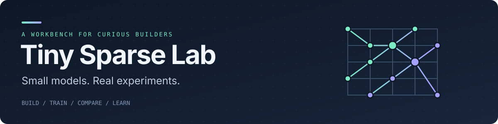
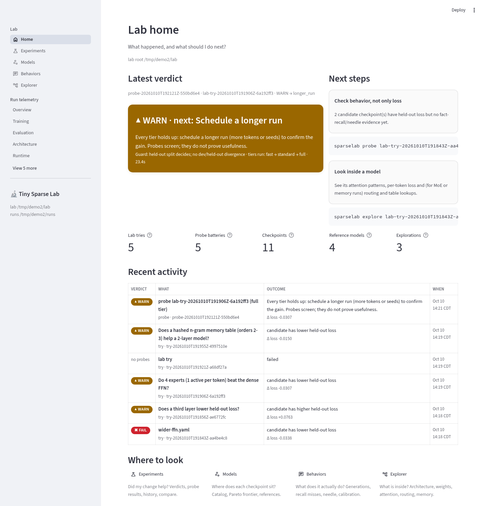

<p align="center">
  
</p>

<p align="center">
  <a href="https://github.com/supernovae/tiny-sparse-lab/actions/workflows/ci.yml"></a>
  <a href="pyproject.toml"></a>
  <a href="LICENSE"></a>
  <a href="docs/experiment-programs.md"></a>
</p>

<p align="center">
  <a href="docs/tinystories-microlab.md">Start with TinyStories</a> ·
  <a href="docs/lab-mode.md">Try an idea</a> ·
  <a href="docs/using-sparselab.md">Find a guide</a>
</p>

Tiny Sparse Lab is a workbench for small language-model experiments. Change a
setting, train a candidate against a baseline, and inspect what actually moved—loss,
probes, generations, and checkpoint internals—all kept together in one local record.

## Workshop & shared experiments

To keep individual experiments decoupled from the core lab engine, recipes and active
studies live in **[Kybern Workshop](https://github.com/supernovae/kybern-workshop)**.
Right now it hosts the experiments Kybern is running as a lab—all of which you can
clone and run directly with SparseLab—and is growing into a public hub for storing
and sharing community experiments:

- **[Basic synthetic CPU](https://github.com/supernovae/kybern-workshop/tree/main/examples/synthetic-cpu)** — Lightweight CPU workflow for quick end-to-end smoke runs and metadata checks.
- **[TinyStories microlab](https://github.com/supernovae/kybern-workshop/tree/main/examples/tinystories-microlab)** — Hands-on starter recipes for training and comparing tiny story models.
- **[DevMind](https://github.com/supernovae/kybern-workshop/tree/main/experiments/devmind)** — Corpus preparation recipes and ongoing study definitions.

Earlier completed and archived studies remain browsable in the Workshop's
[historical catalog](https://github.com/supernovae/kybern-workshop/tree/fd259e2cad4e9856d6d659e8df34728a98b32502/catalog).

## First run

Install **Python 3.14** and [uv](https://docs.astral.sh/uv/), then:

```sh
git clone https://github.com/supernovae/tiny-sparse-lab.git
cd tiny-sparse-lab
uv sync --locked --extra cpu --dev
. .venv/bin/activate
export SPARSELAB_WORK_DIR="$HOME/.local/share/sparselab"
```

Run the setup above in Linux, WSL2, or macOS. Activate `.venv` in each new
terminal; after that commands start with `sparselab` directly. Activation only
adds the installed environment to your shell's `PATH`. Without activation, use
`.venv/bin/sparselab`, or `uv run --locked --no-sync sparselab` after setup.
Direct invocation and `--no-sync` do not check or repair dependency drift.
Repeat the locked sync when changing dependencies or Python, and keep active
experiments on their pinned checkout and environment.

For an already provisioned Windows environment, PowerShell activation is
`.\.venv\Scripts\Activate.ps1` (or invoke `.\.venv\Scripts\sparselab.exe`
directly). Native Windows execution is not qualified by the Linux/WSL tests;
use the Linux commands inside WSL for that supported path.

`--extra cpu` installs the framework dependencies; it is **not a run-on-CPU
flag**. Execution uses the config's `runtime.backend` or a command's supported
`--backend` option. A registered `--runtime ID` selects an existing interpreter
and its runtime profile. Set up vendor GPU environments once using the
[runtime guide](docs/runtime.md#machine-local-runtime-environments); do not sync
the CPU extra into them. There is no generic `--extra gpu` or automatic fallback.

Prefer containers? See the [CPU container guide](docs/containers.md) to run the CLI or
web UI without a host Python install. On a Mac with Apple Silicon, see the
[MLX setup guide](docs/macos-mlx.md).

If you want a guided walkthrough from scratch, start with the
**[Workshop TinyStories microlab](docs/tinystories-microlab.md)**.
If you already have a `RunConfig` and tokenizer ready, jump straight into
**[lab mode](docs/lab-mode.md)**:

```sh
cat > wider-ffn.yaml <<'YAML'
question: Does a wider FFN help at the same token budget?
set:
  model.ffn_dim: 384
YAML
sparselab try wider-ffn.yaml --vs BASELINE.yaml
sparselab report TRY_ID
```

Replace `BASELINE.yaml` with your baseline config and `TRY_ID` with the printed record ID.
`try` prepares data if needed, trains both arms (or reuses a matching completed baseline),
evaluates them on the same held-out split, and runs fast behavioral probes.
Pass `--config standard`, `--config no-probes`, or a [try config file](docs/try-config.md)
to customize paired seeds, probe tiers, or resource limits.

## The everyday lab loop

| Question | Command | What it does |
| --- | --- | --- |
| Does this change help? | `try DELTA.yaml --vs BASELINE.yaml` | Prepares data, trains baseline & candidate, scores held-out loss, and runs fast probes. |
| What happened? | `report TRY_ID` | Summarizes the sealed experiment record and verdict. |
| How does it behave on deeper checks? | `probe TRY_ID --vs BASELINE_RUN --backend cpu --config standard` | Runs deeper probe tiers against both checkpoints. |
| How does this stack up against past runs? | `compare TRY_ID --references` | Compares recorded metrics across compatible runs without re-scoring. |
| What is happening inside the weights? | `explore TRY_ID` | Computes per-token loss, attention maps, weight stats, and routing diagnostics. |

You can pass the same `TRY_ID` across all of these commands (`probe` and `explore`
also accept run IDs or direct checkpoint paths). See [result lookup](docs/result-lookup.md)
for ID resolution details, the [probe guide](docs/probe-battery.md) for probe tiers
and verdicts, and [result reports](docs/result-reports.md) for run-level (`--kind run`)
and research (`--kind research`) report views.

Prefer a visual view? Run `sparselab dashboard` to open the [lab dashboard](docs/dashboard.md)
and browse your experiments, models, probe behaviors, checkpoint internals, and live run telemetry:



## Bring your machine

SparseLab runs on PyTorch across CPU and major GPU backends, plus an optional MLX
engine for Apple Silicon.

| Compute | Engine / backend | Notes |
| --- | --- | --- |
| **CPU** | PyTorch / `cpu` | Works out of the box on Linux, WSL2, and macOS. |
| **NVIDIA GPU** | PyTorch / `cuda` | Requires a compatible CUDA build and driver. Dense SDPA is opt-in; see [kernel checks](docs/hosted-environments.md#boundaries-and-gates). |
| **AMD GPU** | PyTorch / `rocm` | Requires a compatible ROCm build and driver; includes a native HIP sparse-attention path on supported devices. |
| **Intel GPU** | PyTorch / `xpu` | See the [Intel XPU setup guide](docs/intel-xpu.md) for driver and wheel setup. |
| **Apple Silicon GPU** | PyTorch / `mps` | Uses PyTorch's Metal backend on macOS. |
| **Apple Silicon GPU (MLX)** | MLX / `metal` | Optional native Apple Silicon engine supporting FP32 dense and block-sparse training with AdamW. |

See [runtime support](docs/runtime.md) for precision and backend details, and
[lab status](docs/lab-status.md) for tested environment configurations.
Ready to scale past toy runs? Follow the [first-model guide](docs/first-model.md)
to train and evaluate 17.3M-parameter models on FineWeb-Edu.

## Advanced workflows

When you move beyond single-change `try` comparisons, SparseLab includes tools for larger studies:

- **Inspect saved models:** [checkpoint exploration](docs/tinytext-model-guide.md),
  [local API](docs/local-api.md), and the retained [MODEL-0](docs/model-0.md) evidence.
- **Control training and continuation:** [training](docs/training.md),
  [checkpointing](docs/checkpointing.md), [datasets](docs/datasets.md), and
  [instruction objectives](docs/instruction-training.md).
- **Schedule independent runs:** [workers](docs/workers.md) and
  [hosted environments](docs/hosted-environments.md); one host/device per run.
- **Declare release evidence:** [training programs](docs/experiment-programs.md),
  [Campaigns](docs/campaigns.md), [iteration checks](docs/iteration.md), and
  [corpus preparation](docs/corpus-preparation.md).
- **Study mechanisms and findings:** [architecture](docs/architecture.md),
  [papers](papers.md), [research workbench](docs/research/README.md), and
  [experiment ledger](docs/research/experiment-ledger.md).

## Feature matrix

For detailed backend capabilities see the [runtime guide](docs/runtime.md); for past
experimental findings see the [experiment ledger](docs/research/experiment-ledger.md).

| Area | Capabilities | Guide & notes |
| --- | --- | --- |
| **End-to-end training** | Tokenizers, data preparation, training, and text generation via CLI & YAML `RunConfig` | [TinyStories microlab](docs/tinystories-microlab.md) |
| **Attention mechanisms** | Dense, sliding-window, block-sparse, and reference MLA | [Architecture guide](docs/architecture.md) |
| **Conditional capacity** | Local Top-K MoE; token, byte, and portable Engram memory tables | [Capability experiments](docs/capabilities.md) |
| **Training programs** | Parameter matrices, locked `ExperimentPlan` definitions, and multi-phase training | [Experiment programs DSL](docs/experiment-programs.md) |
| **Campaign orchestration** | Multi-run dependency graphs, readiness checks, and result reconciliation | [Campaigns guide](docs/campaigns.md) |
| **Corpus provenance** | Acquire, filter, freeze, export, and verify raw text corpora | [Corpus Forge sample](corpora/devmind-sample-v0/README.md) |
| **Declarative datasets** | Pin Hugging Face Hub sources, snapshot, resume, and track token budgets | [Dataset interfaces](docs/datasets.md) |
| **Instruction tuning** | Full-transcript or assistant-only loss over local multi-turn conversations | [Instruction training](docs/instruction-training.md) |
| **Evaluation & review** | Held-out loss, capability cards, checkpoint-bound probe suites, and blind review | [Evidence guide](docs/evidence.md) |
| **Model diagnostics** | Semantic vector probes, continuation overlap, prep benchmarks, and checkpoint explorer | [CLI diagnostics](docs/using-sparselab.md#native-diagnostic-interfaces) |
| **Remote & queued runs** | Local worker queues, SSH staging, and relay-backed hosted notebooks (e.g. Colab) | [Hosted environments](docs/hosted-environments.md) |
| **Web dashboard** | Visual browser for experiments, verdicts, Pareto frontiers, model behaviors, and weights | [Dashboard tour](docs/dashboard.md) · [Research views](docs/research/dashboard.md) |
| **Interactive playground** | Raw completion, chat transcripts, side-by-side Streamlit comparisons, and local HTTP API | [Model guide](docs/tinytext-model-guide.md) · [Local API](docs/local-api.md) |

Contributions: [CONTRIBUTING.md](CONTRIBUTING.md), [feature roadmap](ROADMAP.md),
[agent guidance](AGENTS.md). Code is [MIT licensed](LICENSE); source datasets
retain their own licenses and attribution.
