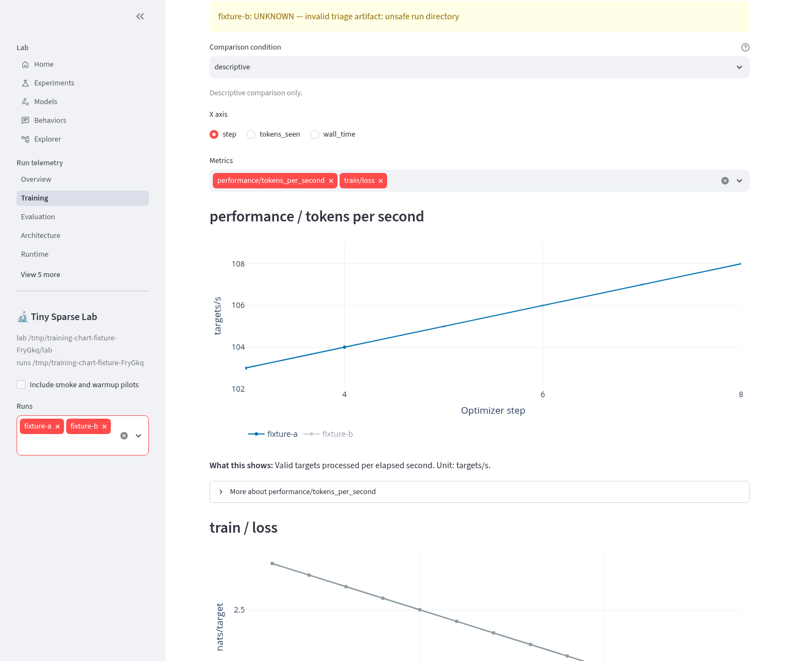
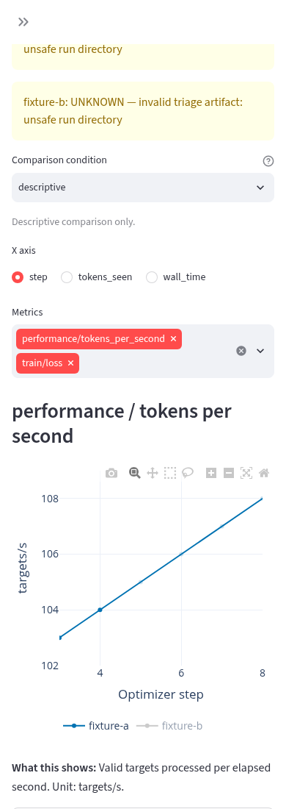

# Training chart refresh validation

Issue #190, synthetic cloud-workspace validation on 2026-10-18. No connection
to the owner's training host, training, checkpoint loading or data download.

## Diagnosis and change

The two-second `render` fragment already avoids full-page reloads. In the locked
Streamlit version, `elements/plotly_chart.py` calls
`compute_and_register_element_id(key_as_main_identity=False, plotly_spec=...)`.
Appending a point changes the built-in chart's identity even with a user key.
On the unmodified page, Chromium observed zero chart-node replacements over
unchanged cycles and one replacement after appending one loss point. This
establishes chart replacement, not a full-page reload, as the reproduced cause.

The training page now uses the existing Streamlit v2 component API and the
installed Plotly bundle, served locally without a CDN or new dependency.
Each metric has a stable component key. Unchanged figure payloads skip plotting;
changed payloads use `Plotly.react` on the existing node. Stable UI revisions
preserve zoom, and series UIDs preserve visibility and point selection. Changing
axis or the available run set intentionally resets chart interaction state.
Resize observers disconnect on cleanup, and removed plots are purged.

Series colors remain consistent across charts even when a run lacks one metric.
Values, recorded x coordinates, missing values and canonical metric units are
unchanged. Each metric has readable axis labels, a wrapping horizontal legend,
a registry-derived explanation directly below it and an optional detailed guide.
Unknown metrics explicitly identify missing canonical descriptions/units.

## Browser evidence

Chromium **151.0.7922.173**, native `/training`, two-second refresh, two synthetic
runs and two metrics. The retained optional browser regression starts its own
loopback server and SQLite fixture. It checks unchanged cycles, appends three
points per series, then checks unchanged cycles again.

- **325 samples at 50 ms:** both original chart nodes and SVG frames remained
  attached; scroll stayed at 700; x zoom stayed `[3, 8]`.
- Hidden second series and selected point indices `[2, 3]` survived all samples.
  Final y zoom remained `[102, 109]`; data increased from 10 to 13 points.
- Changing the x axis reset the zoom, as intended. No browser page errors.
- Interaction state is seeded through Plotly's browser API; this is automated
  DOM/state continuity evidence, not a human recording or a claim about every
  possible display-frame artifact. Firefox, Safari, very large histories and
  high series counts were not tested. Native full-screen mode is not exposed by
  this component; Plotly zoom, pan, selection and image export remain available.

[Machine-readable refresh summary](assets/training-refresh.json).
Raw 50 ms samples were retained in the task workspace at
`/workspace/issue190-final-evidence/refresh.json`.

Desktop, **1440 × 1200**:



Narrow, **390 × 1100**:



The warning in these screenshots is the existing triage reader correctly
refusing a synthetic run with no real run-directory artifacts.

## Repeat the browser check

Use an already provisioned Python environment with the repository dependencies,
and an already installed Playwright Node module and Chromium. No installation
or download is performed by this check. From the repository root:

```sh
PYTHON=/absolute/path/to/environment/bin/python \
NODE_PATH=/absolute/path/to/node_modules \
CHROMIUM=/absolute/path/to/chromium \
node tests/browser/training_live.cjs /tmp/training-chart-evidence
```

`PORT` defaults to 8520. The test creates a private synthetic SQLite directory in
`/tmp`, starts only its own server, and terminates that server on completion.
Screenshots and the raw sample log go to the requested output directory.
